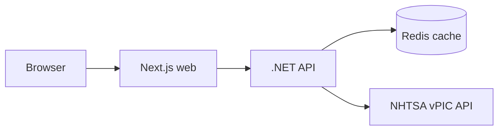

# Decisions

## Architecture

### High level

- **Backend:** a .NET 10 API in 3 layers, `Web → Services → Core`. It sits in front of vPIC, caches it and always answers in one shape.
- **Frontend:** a Next.js app split into Page → Section → Area. It loads the data on the server and shows it with our own `base-*` components.

I used the same layering I use at work, just smaller.

### Details

**Backend**
- **3 projects, `Web → Services → Core`.** `Core` has only contracts (interfaces, DTOs, settings, error codes), `Services` has the logic, `Web` has the controllers. Nothing in `Core` depends on the others.
- **vPIC behind `IVpicClient`, a typed `HttpClient`.** I can test the service with a fake client, and the retry and timeout policy plugs into it.
- **A backend even though vPIC is public.** vPIC only has GET endpoints and needs no key, so the web app could call it directly. I still put an API in front of it to make the reads better: a 24-hour cache with Redis, a make search and a make by id on top of the full make list (vPIC has neither), input validation, retries when vPIC is slow, rate limiting, and one clean response shape for the frontend.
- **One response shape, `ServiceOperationResult<T>`, with real status codes.** The frontend handles every error the same way.
- **Expected errors are results, not exceptions.** Bad input or vPIC being down come back as error codes. Exceptions are only for bugs and go through one global handler.
- **Thin controllers.** They call the service and pick the status code, nothing else.
- **No database.** The app only reads from vPIC, so a cache is enough.

**Frontend**
- **Page → Section → Area with a React context.** The page loads the data once and the areas read it from the context, so no props are passed down.
- **Data loads on the Next.js server.** The browser never calls the API, so the API stays private and pages come with data.
- **The selection lives in the URL.** Reload, share and Back all work.
- **`base-*` components on top of Mantine.** Only the theme folder knows Mantine, so changing the UI library touches one folder.
- **Colours from light and dark tokens.** No colour is hard-coded, so dark mode is just a second token file.
- **Helpers are pure functions.** Easy to read and easy to test later.

## What I added and why
- **Cache:** vPIC answers are kept for 24 hours (HybridCache, with Redis in Docker). The full make list is loaded once and the search runs on it.
- **Rate limit:** 100 calls a minute per user, then 429.
- **Swagger and Serilog:** to try the API and to read the logs.
- **Guided tour:** driver.js. It shows on the first visit, and the button at the bottom right plays it again.
- **All years:** with a make but no year, the list shows the make's models from all years. This uses one more vPIC endpoint, `GetModelsForMakeId`.
- **All makes:** the first screen lists every make, 20 per page, so the page is never empty.

## Trade-offs
- Filter and sort run in the browser, because vPIC can't do them.

## How I used AI
I used Claude Code. First I gave it the context: my architecture for the backend and frontend, the assignment and what I knew about the vPIC API. With that, it helped me write the code one task at a time, and I reviewed and pushed each task myself. At the end I ran my checklist slash commands to check the code against my rules.

What it got wrong:
- **Over-built the first version**
- **Wrong fix for the deploy key**
